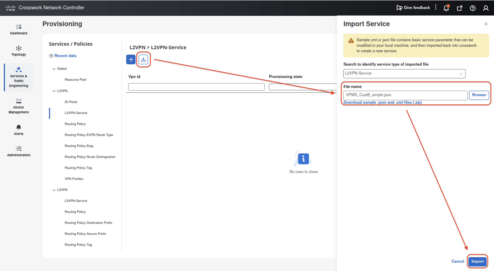
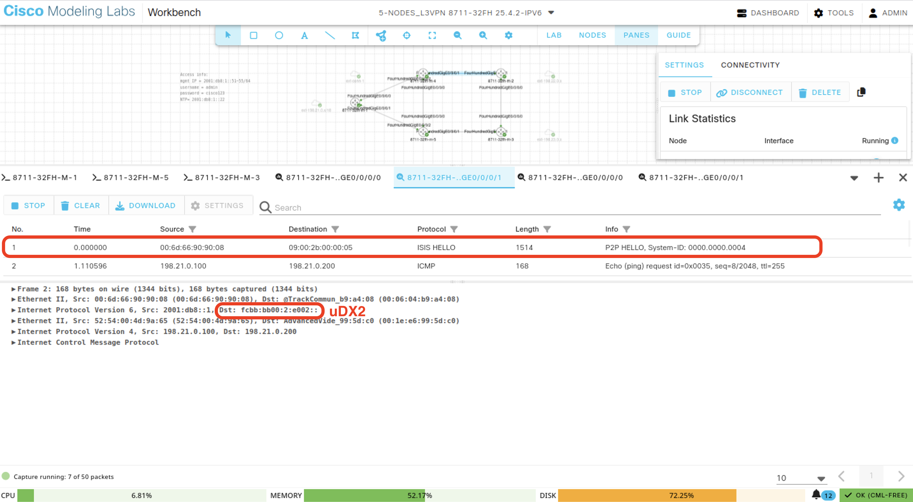
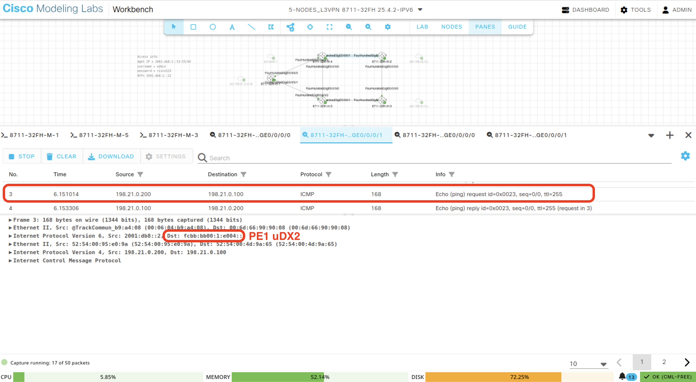
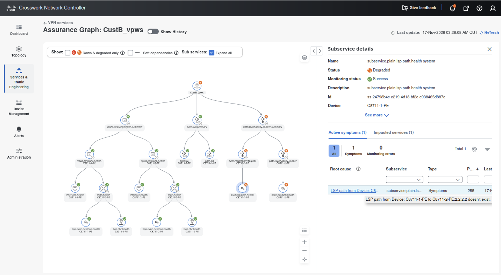

# 7. L2VPN VPWS provisioning

**Time:** 30 minutes

**Objective:** Provision a point-to-point L2VPN (VPWS) from CNC.


CNC 7.2 provisions services based on the IETF L2VPN network model through NSO. VPWS is a point-to-point wire between two attachment circuits. 


| Field | Value |
| --- | --- |
| Service name | `CustB_vpws` |
| vpn-type | point-to-point (vpws-evpn) |
| Endpoints | PE1, PE2 |
| Transport | SRv6 |

### 7.1 Pre-check (ID-Pools)

EVI IDs and Source/Target IDs can be automatically assigned from predefined pools. It is also possible to set fixed values.

In this lab, confirm that those pools are already configured.

1.	Resource pools (ranges of assignable values) are located under **Service & Traffic Engineering > Provisioning (NSO) > Global > Resource Pool**.

    - evi-id-pool: Pool for EVI IDs
    - evi-source-target-pool: Pool for Source/Target IDs

    

    By clicking **Edit** under **Actions**, you can see that the following values are set for each pool. After confirming the values, close the dialog with **Cancel**.

    

    - evi-id-pool: 100-500

    

    - evi-source-target-pool: 1-100

    

2. Confirm that these pools are referenced in the L2VPN configuration under **L2VPN > ID-Pools**.

    - evi-id-pool-name: evi-id-pool
    - evi-source-target-pool-name: evi-source-target-pool

    


### 7.2 Pre-check (MP-BGP Configuration)

MP-BGP configuration is not performed by the built-in L2VPN service model. Therefore, make sure that this configuration is set up in advance and that the BGP neighbors are up.

**PE1 (C8711-1-PE)**
<pre><code>
RP/0/RP0/CPU0:C8711-1-PE#show run router bgp
Fri Nov  6 06:20:18.478 UTC
router bgp 65000
 bgp router-id 1.1.1.1
 address-family vpnv4 unicast
 !
 <mark>address-family l2vpn evpn</mark>
 !
 address-family link-state link-state
 !
 neighbor-group ibgp
  remote-as 65000
  update-source Loopback0
  address-family vpnv4 unicast
  !
  <mark>address-family l2vpn evpn</mark>
  !
 !
 neighbor 2001:db8::2
  use neighbor-group ibgp
 !
 neighbor 2001:db8::3
  use neighbor-group ibgp
 !
 neighbor 2001:db8:1::56
  remote-as 65000
  address-family link-state link-state
  !
 !
!
</code></pre>

<pre><code>
RP/0/RP0/CPU0:C8711-1-PE#show bgp l2vpn evpn neighbors brief
Fri Nov  6 06:20:52.752 UTC

Neighbor         Spk    AS  Description                         Up/Down  NBRState
2001:db8::2       0 65000                                         6d20h <mark>Established</mark>
2001:db8::3       0 65000                                         6d20h <mark>Established</mark>
RP/0/RP0/CPU0:C8711-1-PE#
</code></pre>

### 7.3 Pre-configuration (CEs)

The CEs are located in `CML for PCE` (a different CML instance from the one for the P/PE routers).
Open `CML for PCE` from the Firefox bookmarks bar (use private window). 


Then select the lab `xrv9k-25.4.1-pce-for-CNC7.2-ipv6`.


CE1 is named `csr1000v-ce1`, and CE2 is named `csr1000v-0` in the CML.


**CE1 (CSR1000V-CE1)**

Confirm that `198.21.0.100` is already configured on interface `Gi1` of CE1, which faces PE1.

<pre><code>
ce1>en
ce1#show run int GigabitEthernet 1
Building configuration...

Current configuration : 121 bytes
!
interface GigabitEthernet1
 <mark>ip address 198.21.0.100 255.255.255.0</mark>
 negotiation auto
 no mop enabled
 no mop sysid
end

ce1#
</code></pre>

**CE2 (CSR1000V-0)**

Clear the configuration of interface `Gi1` on CE2, which faces PE2, and reconfigure it with `198.21.0.200`.

<pre><code>
ce2>en
ce2#conf t
ce2(config)#default interface Gi 1
Interface GigabitEthernet1 set to default configuration
ce2(config)#interface GigabitEthernet 1
ce2(config-if)#ip address 198.21.0.<mark>200</mark> 255.255.255.0
ce2(config-if)#end
ce2#
</code></pre>


### 7.4 VPWS Provisioning

1. Go to **Services & Traffic Engineering > Provisioning (NSO)**, then click **L2VPN-Service**.

2. Load **Home > cnc-payloads > VPWS_CustB_simple.json**.

    

    ??? note "VPWS_CustB_simple.json"
        ```json
        {
        "ietf-l2vpn-ntw:l2vpn-ntw": {
            "vpn-services": {
            "vpn-service": [
                {
                "vpn-id": "CustB_vpws",
                "vpn-type": "ietf-vpn-common:vpws-evpn",
                "vpn-nodes": {
                    "vpn-node": [
                    {
                        "vpn-node-id": "C8711-1-PE",
                        "vpn-network-accesses": {
                        "vpn-network-access": [
                            {
                            "id": "0",
                            "interface-id": "FourHundredGigE0/0/0/2",
                            "connection": {
                                "encapsulation": {
                                "encap-type": "ietf-vpn-common:untagged-int"
                                }
                            }
                            }
                        ]
                        },
                        "cisco-l2vpn-ntw:te-service-mapping": {
                        "srv6": {
                            "locator": "srv6"
                        }
                        }
                    },
                    {
                        "vpn-node-id": "C8711-2-PE",
                        "vpn-network-accesses": {
                        "vpn-network-access": [
                            {
                            "id": "0",
                            "interface-id": "FourHundredGigE0/0/0/2",
                            "connection": {
                                "encapsulation": {
                                "encap-type": "ietf-vpn-common:untagged-int"
                                }
                            }
                            }
                        ]
                        },
                        "cisco-l2vpn-ntw:te-service-mapping": {
                        "srv6": {
                            "locator": "srv6"
                        }
                        }
                    }
                    ]
                },
                "cisco-l2vpn-ntw:auto-evi-id": [
                    null
                ],
                "cisco-l2vpn-ntw:auto-evi-source": [
                    null
                ],
                "cisco-l2vpn-ntw:auto-evi-target": [
                    null
                ],
                "cisco-l2vpn-ntw:service-assurance": {
                    "monitoring-state": "enable",
                    "profile-name": "Gold_L2VPN_ConfigProfile system",
                    "rule-name": "Rule-L2VPN-NM system"
                }
                }
            ]
            }
        }
        }
        ```

3. Confirm that the following parameters are set.
    - vpn-id: `CustB_vpws`
    - vpn-type: `vpws-evpn`

    

    - auto-evi-id: enabled
    - auto-evi-source: enabled
    - auto-evi-target: enabled

    (With these settings, EVI IDs and Source/Target IDs are automatically assigned from predefined pools.)

    

    - vpn-node: **C8711-1-PE**
    - vpn-network-access: FourHundredGigE0/0/0/2
    - encap-type: untagged-int
    - srv6 locator: `srv6`  
    (In this scenario, there is no route policy configuration.)

    
    

    - vpn-node: **C8711-2-PE**
    - vpn-network-access: FourHundredGigE0/0/0/2
    - encap-type: untagged-int
    - srv6 locator: `srv6`  
    (In this scenario, there is no route policy configuration.)

    
    

    **Service Assurance** 

    - enable `service-assurance`
    - monitoring state: enable
    - preservation: remove (delete all historical data when monitoring stops)
    - profile-name: `Gold_L2VPN_ConfigProfile system`
    - rule-name: `Rule-L2VPN-NM system`

    

4. Click **Dry-run** to confirm the configuration. 

    

    You can switch the display by using **Show changes** in the upper right.
    

5. Click **Commit changes**.

    


## 7.5 Confirm the L2VPN

### via CNC GUI
1. Open **Services & Traffic Engineering > VPN Services**.
2. Select `CustB_vpws`.

    


### via CLI

On PE1/PE2:  

Confirm that a uDX2 SID is assigned to `CustB_vpws`.

<pre><code>
RP/0/RP0/CPU0:C8711-1-PE#show segment-routing srv6 locator srv6 sid
Fri Nov  6 08:20:24.085 UTC
SID                         Behavior          Identification                    Owner               State  RW
--------------------------  ----------------  --------------------------------  ------------------  -----  --
fcbb:bb00:1::               uN (PSP/USD)      'default':1                       sidmgr              InUse  Y
fcbb:bb00:1:e000::          uA (PSP/USD)      [FH0/0/0/0, Link-Local]:0         isis-1              InUse  Y
fcbb:bb00:1:e001::          uA (PSP/USD)      [FH0/0/0/1, Link-Local]:0         isis-1              InUse  Y
fcbb:bb00:1:e002::          uB6 (PSP/USD Insert.Red)  'srte_c_10_ep_2001:db8::2' (10, 2001:db8::2)  xtc_srv6            InUse  Y
fcbb:bb00:1:e003::          uB6 (PSP/USD Insert.Red)  'srte_c_20_ep_2001:db8::3' (20, 2001:db8::3)  xtc_srv6            InUse  Y
<mark>fcbb:bb00:1:e004::          uDX2              100:1                             l2vpn_srv6          InUse  Y</mark>
RP/0/RP0/CPU0:C8711-1-PE#
</code></pre>


Confirm that the VPWS `CustB_vpws` is up.

<pre><code>
RP/0/RP0/CPU0:C8711-1-PE#show l2vpn xconnect
Fri Nov  6 08:21:20.013 UTC
Legend: ST = State, UP = Up, DN = Down, AD = Admin Down, UR = Unresolved,
        SB = Standby, SR = Standby Ready, (PP) = Partially Programmed,
        LU = Local Up, RU = Remote Up, CO = Connected, (SI) = Seamless Inactive

XConnect                   Segment 1                       Segment 2
Group      Name       ST   Description            ST       Description            ST
------------------------   -----------------------------   -----------------------------
CustB_vpws CustB_vpws UP   FH0/0/0/2              UP       EVPN 100,1,1           UP
----------------------------------------------------------------------------------------
RP/0/RP0/CPU0:C8711-1-PE#
</code></pre>

Check connectivity between the CEs.  
Due to lab constraints, the ping may not succeed.

On CE1(csr1000v-CE1):
```
ce1#ping 198.21.0.200
Type escape sequence to abort.
Sending 5, 100-byte ICMP Echos to 198.21.0.200, timeout is 2 seconds:
!!!!!
Success rate is 100 percent (5/5), round-trip min/avg/max = 3/13/50 ms
ce1#
```

## 7.6 Packet Capture (Optional)

Use the packet capture feature of CML to observe the encapsulation in the IPv6 header.

**CE1 to CE2**

1. Start a ping from `CE1` to `CE2`.

    On CE1(csr1000v-CE1):
    ```
    ce1#ping 198.21.0.200 repeat 100
    ```

2. Right-click the link between `P4` and `PE2`.

3. Start a packet capture.

4. Select the ICMP echo request packet from 198.21.0.100 to 198.21.0.200.

5. Find the IPv6 header. The destination address should be the uDX2 SID of PE2 (for example, fcbb:bb00:2:e002::). 

    


**CE2 to CE1**

1. Start a ping from `CE2` to `CE1`.

    On CE2(csr1000v-0):
    ```
    ce2#ping 198.21.0.100 repeat 100
    ```

2. Right-click the link between `PE2` and `P4`.

3. Start a packet capture.

4. Select the ICMP echo request packet from 198.21.0.200 to 198.21.0.100.

5. Find the IPv6 header. The destination address should be the uDX2 SID of PE1 (for example, fcbb:bb00:1:e004::). 

    


## 7.7 Service Health

1. Open **Services & Traffic Engineering > VPN Services**.
2. Confirm that the health of `CustB_vpws` is **Degraded**.
3. Click **Actions > Assurance graph**

    

4. Drill down into this graph to see the symptoms.

    

    - **Fallback LSP path from Device: C8711-2-PE to C8711-1-PE:1.1.1.1 doesn't exist.**
    - **Fallback LSP path from Device: C8711-1-PE to C8711-2-PE:2.2.2.2 doesn't exist.** 

    For example, these two are monitoring items that check reachability to the BGP router ID of the remote PE. In this case, these alerts occur because the IPv4 address of the loopback interface of the remote PE has not been learned.

    ```
    RP/0/RP0/CPU0:C8711-1-PE#show ip route
    Fri Nov  6 05:06:12.166 UTC

    % No matching routes found

    RP/0/RP0/CPU0:C8711-1-PE#
    ```

    You can check which metrics are being collected by searching for the metric name in **Administration > Heuristic Packages**.

    
    


## 7.8 Done when

- [ ] `CustB_vpws` is up and shown as point-to-point in VPN Services.


## 7.9 Clean-up rule

1. Go to **Services & Traffic Engineering > Provisioning (NSO)**, then click **L2VPN-Service**. 

2. Select **Delete dry run** from **Actions**.

    

3. Check the configuration diff and click **Delete**.

    


