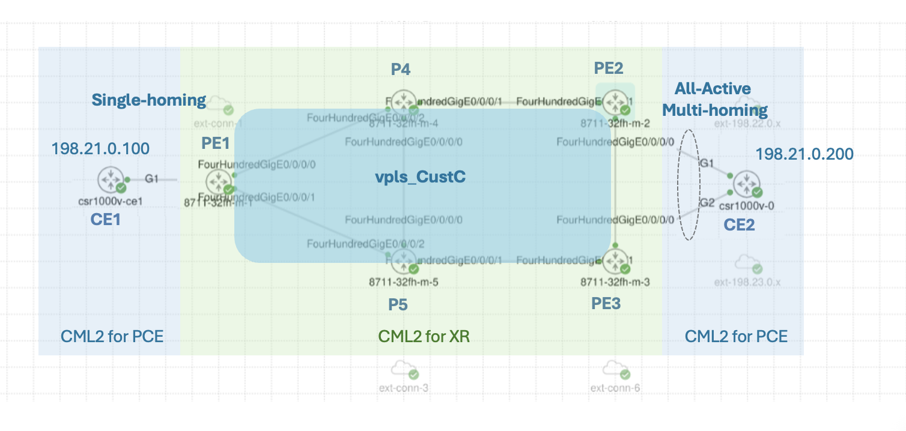
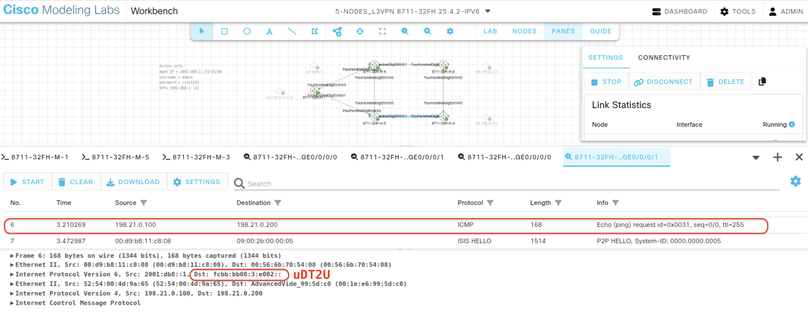
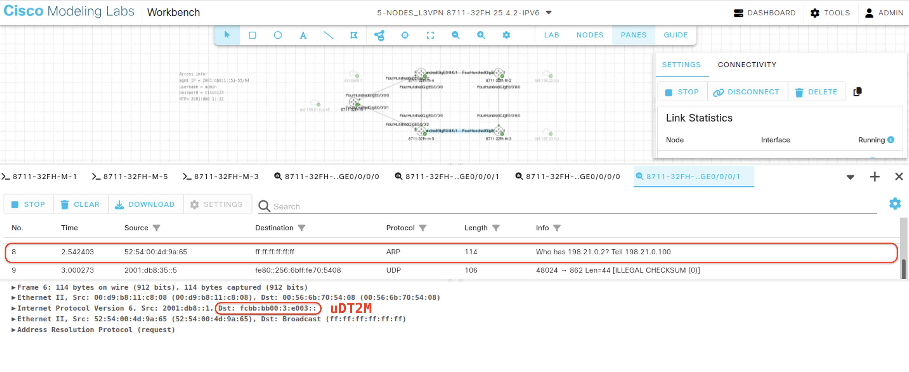
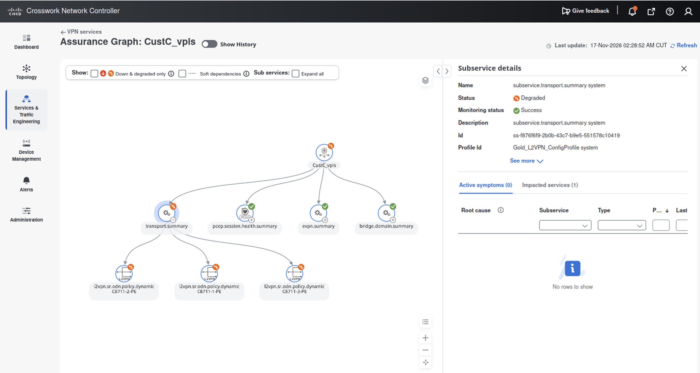

# 8. L2VPN VPLS provisioning

**Time:** 30 minutes

**Objective:** Provision a multipoint LAN (VPLS) from CNC.

Configure VPLS with a **Single-homing** configuration on the CE1 side (connected only to PE1) and an **All-Active Multi-homing** configuration on the CE2 side (connected to both PE2 and PE3). 



| Field | Value |
| --- | --- |
| Service name | `CustC_vpls` |
| vpn-type | multi-point (evpn) |
| Endpoints | PE1, PE2, PE3 |
| Redundancy | CE1-PE1: Single-homing, CE2-PE2&PE3: All-Active Multi-homing |
| Transport | SRv6 |

## 8.1 CE Interface Settings

The CEs are located in `CML for PCE` (a different CML instance from the one for the P/PE routers).
Open `CML for PCE` from the Firefox bookmarks bar (use private window). 


Then select the lab `xrv9k-25.4.1-pce-for-CNC7.2-ipv6`.


CE1 is named `csr1000v-ce1`, and CE2 is named `csr1000v-0` in the CML.


**CE1 (CSR1000V-CE1)**

Confirm that `198.21.0.100` is already configured on interface `Gi1` of CE1, which faces PE1.

<pre><code>
ce1>en
ce1#show run int GigabitEthernet 1
Building configuration...

Current configuration : 121 bytes
!
interface GigabitEthernet1
 <mark>ip address 198.21.0.100 255.255.255.0</mark>
 negotiation auto
 no mop enabled
 no mop sysid
end

ce1#
</code></pre>

**CE2 (CSR1000V-0)**

Clear the configuration of interfaces `Gi1` and `Gi2` on CE2, which face PE2 and PE3, and reconfigure them as member ports of `Port-channel 1`.

<pre><code>
conf t
default interface Gi 1
default interface Gi 2
!
interface Port-Channel 1
 <mark>ip address 198.21.0.200 255.255.255.0</mark>
!
interface range GigabitEthernet 1-2
 channel-group 1
 no negotiation auto
end
</code></pre>

## 8.2 Configure Bundle-Ether on PE2/PE3

In this lab, the PEs and CEs are connected through an external connector, so LACP negotiation cannot be performed. Therefore, force the bundle member to come up by using `mode on`.

**PE2 and PE3**
```
interface FourHundredGigE0/0/0/2
 bundle id 1 mode on
 no shut
!
interface Bundle-Ether1
 lacp system mac 2323.2323.2323
!
```

 Go to **Device Management > Network Devices**, select PE2 and PE3, and choose **Sync-from devices to NSO** from **Actions**.
 
 


## 8.3 VPLS Provisioning

1. Go to **Services & Traffic Engineering > Provisioning (NSO)**, then click **L2VPN-Service**.

2. Load **Home > cnc-payloads > VPLS_CustC.json**.

    

    ??? note "VPLS_CustC.json"
        ```json
        {
        "ietf-l2vpn-ntw:l2vpn-ntw": {
            "vpn-services": {
            "vpn-service": [
                {
                "vpn-id": "CustC_vpls",
                "vpn-type": "ietf-vpn-common:mpls-evpn",
                "vpn-service-topology": "ietf-vpn-common:any-to-any",
                "vpn-nodes": {
                    "vpn-node": [
                    {
                        "vpn-node-id": "C8711-1-PE",
                        "signaling-option": {
                        "evpn-policies": {
                            "mac-learning-mode": "ietf-l2vpn-ntw:control-plane"
                        }
                        },
                        "vpn-network-accesses": {
                        "vpn-network-access": [
                            {
                            "id": "0",
                            "interface-id": "FourHundredGigE0/0/0/2",
                                "connection": {
                                "encapsulation": {
                                "encap-type": "ietf-vpn-common:untagged-int"
                                }
                            }
                            }
                        ]
                        },
                        "cisco-l2vpn-ntw:te-service-mapping": {
                        "srv6": {
                            "locator": "srv6"
                        },
                        "te-mapping": {
                            "odn": {
                            "route-policy": [
                                "POLICY3"
                            ]
                            }
                        }
                        }
                    },
                    {
                        "vpn-node-id": "C8711-2-PE",
                        "signaling-option": {
                        "evpn-policies": {
                            "mac-learning-mode": "ietf-l2vpn-ntw:control-plane"
                        }
                        },
                        "vpn-network-accesses": {
                        "vpn-network-access": [
                            {
                            "id": "0",
                            "interface-id": "Bundle-Ether1",
                                "connection": {
                                "encapsulation": {
                                "encap-type": "ietf-vpn-common:untagged-int"
                                }
                            }
                            }
                        ]
                        },
                        "cisco-l2vpn-ntw:multi-home": {
                        "ethernet-segment-identifier": "23.23.00.00.00.00.00.00.00"
                        },
                        "cisco-l2vpn-ntw:te-service-mapping": {
                        "srv6": {
                            "locator": "srv6"
                        },
                        "te-mapping": {
                            "odn": {
                            "route-policy": [
                                "POLICY3"
                            ]
                            }
                        }
                        }
                    },
                    {
                        "vpn-node-id": "C8711-3-PE",
                        "signaling-option": {
                        "evpn-policies": {
                            "mac-learning-mode": "ietf-l2vpn-ntw:control-plane"
                        }
                        },
                        "vpn-network-accesses": {
                        "vpn-network-access": [
                            {
                            "id": "0",
                            "interface-id": "Bundle-Ether1",
                                "connection": {
                                "encapsulation": {
                                "encap-type": "ietf-vpn-common:untagged-int"
                                }
                            }
                            }
                        ]
                        },
                        "cisco-l2vpn-ntw:multi-home": {
                        "ethernet-segment-identifier": "23.23.00.00.00.00.00.00.00"
                        },
                        "cisco-l2vpn-ntw:te-service-mapping": {
                        "srv6": {
                            "locator": "srv6"
                        },
                        "te-mapping": {
                            "odn": {
                            "route-policy": [
                                "POLICY3"
                            ]
                            }
                        }
                        }
                    }
                    ]
                },
                "cisco-l2vpn-ntw:auto-evi-id": [
                    null
                ],
                "cisco-l2vpn-ntw:bridge-group": "BRIDGE",
                "cisco-l2vpn-ntw:service-assurance": {
                    "monitoring-state": "enable",
                    "profile-name": "Gold_L2VPN_ConfigProfile system",
                    "rule-name": "Rule-L2VPN-MP system"
                }
                }
            ]
            }
        }
        }
        ```

3. Confirm that the following parameters are set.

    - vpn-id: `CustC_vpls`
    - vpn-type: `mpls-evpn`
    - vpn-service-topology: `any-to-any`
    - auto-evi-id: enabled
    - bridge-group: `BRIDGE`

    

    - vpn-node: **C8711-1-PE**
    - mac-learning-mode: control-plane
    - vpn-network-access: FourHundredGigE0/0/0/2
    - encap-type: untagged-int
    - srv6 locator: `srv6`  

    
    

    - vpn-node: **C8711-2-PE**
    - mac-learning-mode: control-plane
    - vpn-network-access: Bundle-Ether1
    - encap-type: untagged-int
    - multi-home:
        - ethernet-segment-identifier: 23.23.00.00.00.00.00.00.00
    - srv6 locator: `srv6`  

    
    
    

    - vpn-node: **C8711-3-PE**
    - mac-learning-mode: control-plane
    - vpn-network-access: Bundle-Ether1
    - encap-type: untagged-int
    - multi-home:
        - ethernet-segment-identifier: 23.23.00.00.00.00.00.00.00
    - srv6 locator: `srv6`  

    
    
    


    **Service Assurance** 

    - enable `service-assurance`
    - monitoring state: enable
    - preservation: remove (delete all historical data when monitoring stops)
    - profile-name: `Gold_L2VPN_ConfigProfile system`
    - rule-name: `Rule-L2VPN-MP system`

    

4. Click **Dry-run**, and then click **Commit changes**.


## 8.4 Confirm the VPLS

### via CNC GUI
1. Open **Services & Traffic Engineering > VPN Services**.
2. Select `CustC_vpls`.

    


### via CLI

On PE1/PE2/PE3:  

Confirm that uDT2U/uDT2M SIDs are assigned to `CustC_vpls`.

<pre><code>
RP/0/RP0/CPU0:C8711-1-PE#show segment-routing srv6 locator srv6 sid
Sat Nov  7 15:47:22.551 UTC
SID                         Behavior          Identification                    Owner               State  RW
--------------------------  ----------------  --------------------------------  ------------------  -----  --
fcbb:bb00:1::               uN (PSP/USD)      'default':1                       sidmgr              InUse  Y
fcbb:bb00:1:e000::          uA (PSP/USD)      [FH0/0/0/0, Link-Local]:0         isis-1              InUse  Y
fcbb:bb00:1:e001::          uA (PSP/USD)      [FH0/0/0/1, Link-Local]:0         isis-1              InUse  Y
fcbb:bb00:1:e002::          uB6 (PSP/USD Insert.Red)  'srte_c_10_ep_2001:db8::2' (10, 2001:db8::2)  xtc_srv6            InUse  Y
fcbb:bb00:1:e003::          uB6 (PSP/USD Insert.Red)  'srte_c_20_ep_2001:db8::3' (20, 2001:db8::3)  xtc_srv6            InUse  Y
<mark>fcbb:bb00:1:e004::          uDT2U             100:0                             l2vpn_srv6          InUse  Y</mark>
<mark>fcbb:bb00:1:e005::          uDT2M             100:0                             l2vpn_srv6          InUse  Y</mark>
RP/0/RP0/CPU0:C8711-1-PE#
</code></pre>


Confirm that MAC addresses are learned between the PEs.  
You may not see any address because it takes time.

<pre><code>
RP/0/RP0/CPU0:C8711-1-PE#show evpn evi vpn-id 100 mac
Sat Nov  7 15:51:19.199 UTC

VPN-ID     Encap      MAC address    IP address                               Nexthop                                 Label    SID
---------- ---------- -------------- ---------------------------------------- --------------------------------------- -------- ---------------------------------------
100        SRv6       3e0c.fefb.7071 ::                                       FourHundredGigE0/0/0/2                  0        fcbb:bb00:1:e004::
100        SRv6       62ab.683d.a500 ::                                       2001:db8::2                             IMP-NULL fcbb:bb00:2:e002::
100        SRv6       62ab.683d.a500 ::                                       2001:db8::3                             IMP-NULL fcbb:bb00:3:e002::
100        SRv6       e613.d71f.529b ::                                       FourHundredGigE0/0/0/2                  0        fcbb:bb00:1:e004::
RP/0/RP0/CPU0:C8711-1-PE#
</code></pre>

You can confirm that PE2 and PE3 are operating in all-active multi-homing mode by using the following command.

On **PE2/PE3**:
<pre><code>
RP/0/RP0/CPU0:C8711-2-PE#show evpn ethernet-segment esi 0023.2300.0000.0000.0000 detail
Sat Nov  7 16:11:46.047 UTC

Ethernet Segment Id      Interface                          Originating IP
------------------------ ---------------------------------- --------------------
0023.2300.0000.0000.0000 BE1                                <mark>2.2.2.2</mark>
                                                            <mark>3.3.3.3</mark>
  ES to BGP Gates   : Ready
  ES to L2FIB Gates : Ready
  Main port         :
     Interface name : Bundle-Ether1
     Interface MAC  : 0006.04b9.a505
     IfHandle       : 0x7800002c
     State          : Up
     Redundancy     : Not Defined
  ESI ID            : 1
  ESI type          : 0
     Value          : 0023.2300.0000.0000.0000
  ES Import RT      : 2323.0000.0000 (from ESI)
  Topology          :
     Operational    : <mark>MH, All-active</mark>
     Configured     : All-active (AApF) (default)
  Service Carving   : Auto-selection
     Multicast      : Disabled
  Convergence       :
  Peering Details   : 2 Nexthops
     2.2.2.2 [MOD:P:00:T]
     3.3.3.3 [MOD:P:00:T]
  Service Carving Synchronization:
     Mode           : NTP_SCT
     Peer Updates   :
                 2.2.2.2 [SCT: 2026-11-07 15:45:44.1794066]
                 3.3.3.3 [SCT: 2026-11-07 15:45:47.1794066]
  Service Carving Results:
     Forwarders     : 1
     Elected        : 1
     Not Elected    : 0
  EVPN-VPWS Service Carving Results:
     Primary        : 0
     Backup         : 0
     Non-DF         : 0
  MAC Flush msg     : STP-TCN
  Peering timer     : 3 sec [not running]
  Recovery timer    : 30 sec [not running]
  Carving timer     : 0 sec [not running]
  Revert timer      : 0 sec [not running]
  HRW Reset timer   : 5 sec [not running]
  Local SHG filters :
      (mpls)                None
      (srv6)                1:16
  Remote SHG filters: 1
      (srv6)                1:16 : nexthop 2001:db8::3
  Access signal mode: Bundle OOS

RP/0/RP0/CPU0:C8711-2-PE#
</code></pre>

## 8.5 Connectivity Check

Because of lab constraints, CE2 cannot receive ARP replies, so configure a static ARP entry on CE2.

On **CE1(csr1000v-ce1)**:
```
ce1#show arp
Protocol  Address          Age (min)  Hardware Addr   Type   Interface
Internet  198.21.0.100            -   5254.004d.9a65  ARPA   GigabitEthernet1
Internet  198.21.0.200            5   001e.e699.5dc0  ARPA   GigabitEthernet1
ce1#
```

On **CE2(csr1000v-0)**:
```
ce2#show arp
Protocol  Address          Age (min)  Hardware Addr   Type   Interface
Internet  198.21.0.100            0   Incomplete      ARPA   
Internet  198.21.0.200            -   001e.e699.5dc0  ARPA   Port-channel1
ce2#
```

```
ce2#conf t
ce2(config)#arp 198.21.0.100 5254.004d.9a65 arpa 
ce2(config)#end
```

```
ce2#show arp
Protocol  Address          Age (min)  Hardware Addr   Type   Interface
Internet  198.21.0.100            -   5254.004d.9a65  ARPA  
Internet  198.21.0.200            -   001e.e699.5dc0  ARPA   Port-channel1
ce2#
```

Ping between the CEs. 

!!! warning "Note"
    This lab can be unstable because it uses external connectors for PE-CE connectivity. Pings may occasionally fail.

```
ce2#ping 198.21.0.100
Type escape sequence to abort.
Sending 5, 100-byte ICMP Echos to 198.21.0.100, timeout is 2 seconds:
!!!!!
Success rate is 100 percent (5/5), round-trip min/avg/max = 4/6/13 ms
ce2#
```

## 8.6 Packet Capture (Optional)

Use the packet capture feature of CML to observe the encapsulation in the IPv6 header.

**Unicast Traffic (uDT2U)**  
1. Start a ping from `CE1` to `CE2`.
   Due to lab constraints, the ping may not succeed, but this is not a problem.

    On CE1(csr1000v-CE1):
    ce1#ping 198.21.0.200 repeat 10

2. Right-click the link between `P5` and `PE3` and start a packet capture.

3. Select the ICMP echo request packet from 198.21.0.100 to 198.21.0.200.

4. Find the IPv6 header. The destination address contains the uDT2U SID of PE3 (for example, fcbb:bb00:3:e002::). 

    

**Unknown Unicast Traffic (uDT2M)**  
1. Start a ping from `CE1` to the unknown address. 

    On CE1(csr1000v-CE1):
    ce1#ping 198.21.0.2 repeat 10

2. Right-click the link between `P5` and `PE3` and start a packet capture.

3. Select the ARP packet from 198.21.0.100 to 198.21.0.2.

4. Find the IPv6 header. The destination address contains the uDT2M SID of PE3 (for example, fcbb:bb00:3:e003::). 

    

## 8.7 Service Health

1. Open **Services & Traffic Engineering > VPN Services**.
2. Confirm that the health of `CustC_vpls` is **Good**.
3. Click **Actions > Assurance graph**

    

4. Drill down into this graph and check the status.

    

    In this case, although steering to the ODN policy was configured, these symptoms occurred because the ODN policy had not yet been instantiated at that point.


## 8.8 Done when

- [ ] `CustC_vpls` is up and shown as multi-point in VPN Services.


## 8.9 Clean-up rule

1. Go to **Services & Traffic Engineering > Provisioning (NSO)**, then click **L2VPN-Service**. 

3. Select **Delete dry run** from **Actions**.

    

4. Check the configuration diff and click **Delete**.

    


